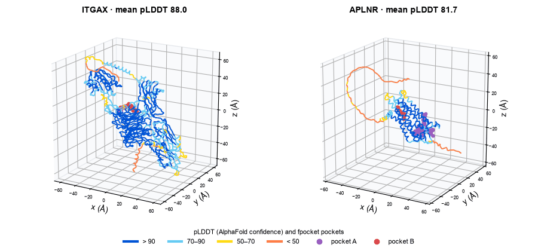
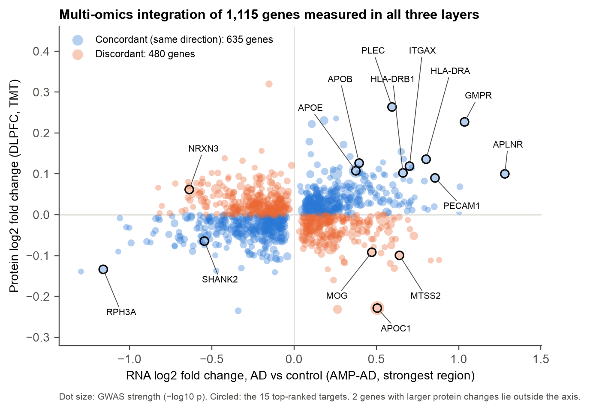
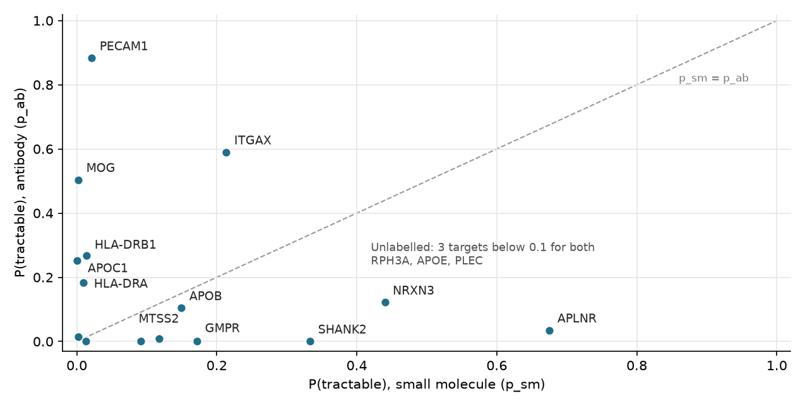
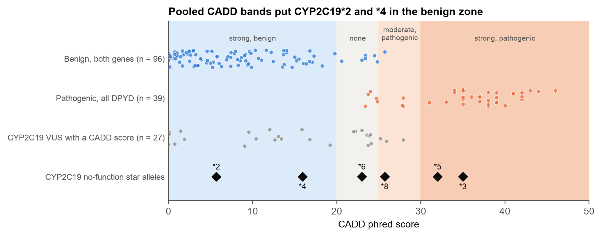
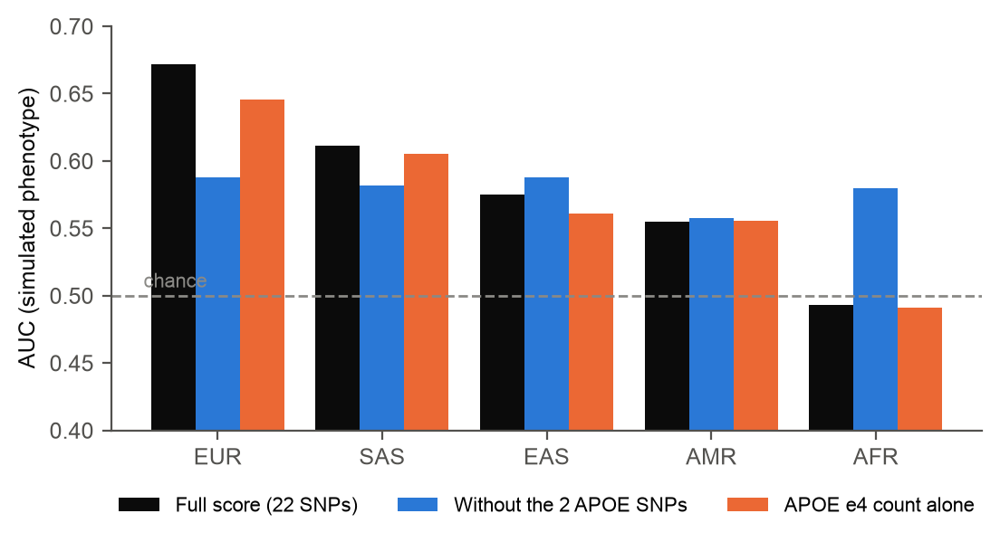
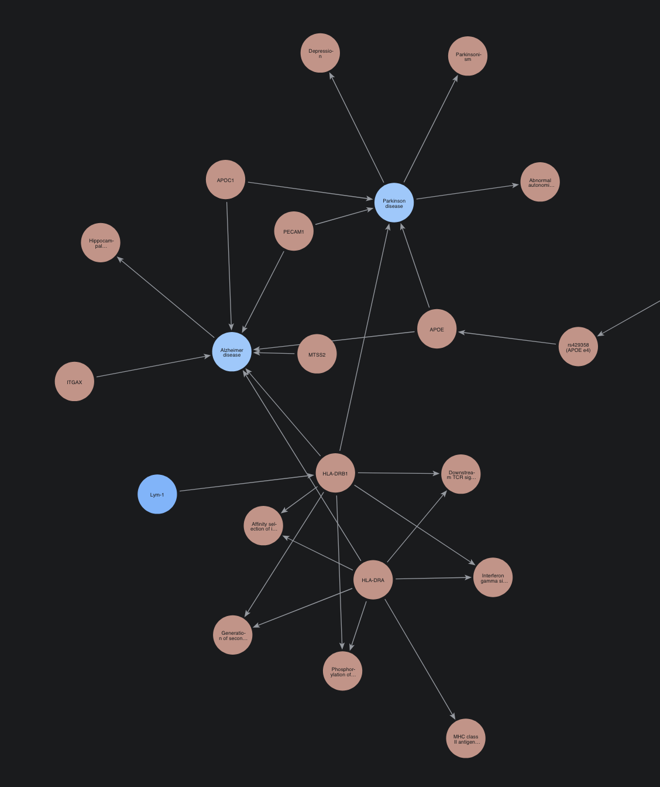

# BIOT 6900 coursework

[](https://dhairyab0069.github.io/biot6900-io/)
[](https://github.com/dhairyab0069/biot6900)



*The AlphaFold models of my two lead Alzheimer's targets, coloured by how confident AlphaFold is in each
part (pLDDT). Purple and red points are pockets found by fpocket. On APLNR (right), the purple pocket is
where a real drug binds in the lab structure.*

*Jump to:* [Summary](#summary) · [Findings](#findings) · [Results](#4-results) · [Limitations](#5-limitations) · [Reproduce it](#6-how-to-reproduce) · [Where things are](#7-where-things-are) · [Interactive report](https://dhairyab0069.github.io/biot6900-io/)

## Summary

This is my BIOT 6900 coursework, by Dhairya Bhatia (Northeastern University). The course has three parts, and the disease or data set changes where an assignment fixed its own data. The first half follows one disease, Alzheimer's, from genes to drug pockets. The second half asks other genomics questions: drug response, genetic risk across ancestries, a knowledge graph, and a breast cancer single-cell and spatial view. The third part checks clinical models, on a synthetic HIV cohort and on colon tissue images. One habit ties it all together: after each result, I asked if it can be trusted.

### The course in one table

| Part | Modules | Disease or topic | Question | Folder |
|---|---|---|---|---|
| I | 2 to 4, Portfolio 1 | Alzheimer's disease | Which genes are involved, which could a drug reach, and is there a pocket? | `module2`, `module3`, `module4`, `portfolio1` |
| II | 5 | Drug response, CYP2C19 (assigned gene) | Can variant scores classify the gene's uncertain variants? | `module5` |
| II | 6 | Alzheimer's disease | Does a risk score work across ancestries? | `module6` |
| II | 7 | Alzheimer's disease | What does connecting all my evidence add? | `module7` |
| II | 8 | Breast cancer | Which cells express a target, and where do they sit in the tumour? | `module8` |
| II | Portfolio 2 | Modules 5 to 8 together | Skeleton so far | `portfolio2` |
| III | 9 | HIV (synthetic cohort) | How much of a clinical model's skill is leakage? | `module9` |
| III | 10 | Colorectal cancer (tissue images) | Does a pathology model learn tissue or a scanner tag? | `module10` |

Module 1 is setup (`module1`).

### How the pieces connect

*Part I, one disease:* I chose Alzheimer's in Module 2 and kept it, so each module builds on the last: RNA, protein and DNA evidence (Module 2), druggability with protein language models (Module 3), and AlphaFold structures and pockets (Module 4). Portfolio 1 brings these into one shortlist.

*Part II, new questions:* Modules 5 and 8 came with their own data (an assigned gene, CYP2C19, and a breast cancer single-cell and Visium data set), so they do not follow Alzheimer's. Modules 6 and 7 return to Alzheimer's: how a published risk score carries across ancestries, and a knowledge graph that connects the evidence for my genes.

*Part III, clinical models:* Module 9 uses a synthetic HIV cohort and Module 10 uses PathMNIST colon tissue images. Both ask about the same risk: a model that scores well because of something other than the disease.

*The common thread:* every module ended with a check. Known Alzheimer's genes ranked near the top (Module 2). CADD called CYP2C19's own broken alleles benign (Module 5). The risk score was at chance in one ancestry group (Module 6). Integration was judged with scores (Module 8). Removing leakage cut an AUROC from 0.910 to 0.712 (Module 9). A barcode on one class turned out to be a shortcut (Module 10).

## Findings

*Part I and Part II, Alzheimer's and CYP2C19 (Modules 2 to 7):*

- **1,115 genes have evidence in brain RNA, brain protein and DNA at the same time.** Known Alzheimer's genes
  rank near the top (HLA-DRB1 2nd, APOE 11th, CLU 31st), which made me more confident in the method
  (Section 4.1).
- **Most of my top 15 suit antibodies, not pills.** They are mostly cell-surface proteins. APLNR, a
  G-protein-coupled receptor, is the one clear small-molecule candidate. APOE, the strongest genetic signal,
  looks like no drugged protein (Section 4.2).
- **APLNR has a confident pocket where a real drug binds; ITGAX has none.** The drug site in APLNR's
  predicted structure has a pLDDT of 95.1, even though fpocket ranks that pocket only 4th (Section 4.3).
- **My final shortlist is APLNR, ITGAX, PECAM1, HLA-DRB1 and APOE** (Section 4.4).
- **For CYP2C19, variant scores can't be trusted.** CADD puts the gene's own known broken alleles, \*2 and
  \*4, in the "benign" band, so I left all 33 uncertain variants as uncertain (Section 4.5).
- **A published Alzheimer's risk score works best in Europeans (AUC 0.672) and is at chance in the
  African-ancestry group (0.493).** Without its two APOE SNPs every group sits near 0.58, so the drop comes
  from how the course data simulated APOE, not from APOE biology (Section 4.6).
- **A knowledge graph of my genes ranks PECAM1, APOC1, ITGAX, HLA-DRB1 and APOE on top.** Fusing network
  position with my scores puts four of my five shortlist genes in the top five, finds real drugs on APOB and
  APLNR, and links HLA-DRB1 to Parkinson's through shared symptoms (Section 4.7).

*Part II, single-cell and spatial (Module 8):*

- Harmony mixed donors better than my scVI run (donor silhouette -0.082 against -0.029; 0.091 with no integration). All cell-type silhouettes were near zero (-0.010 to 0.026), so the scores could not separate the methods on biology.
- EPCAM was not a clean tumour marker in my sample. All 152 tumour cells came from one donor, and EPCAM was also detected in 26.7% of T cells, from about 5% to 71.5% depending on the donor (Section 4.8).

*Part III, clinical models (Modules 9 and 10):*

- In the HIV cohort the model's AUROC fell from 0.910 to 0.712 once all leakage was removed, so about 48% of its skill above chance was leakage (Section 4.9).
- In the colon tissue images, a barcode added to tumour images only was learned: the model's tumour recall fell from 100.0% to 37.0% without it, and it scored 20.2% when the barcode moved to normal images. A clean control reacted much less (23.0% flips against 96.7%) (Section 4.10).

## 1. Background

*This background is for the Alzheimer's modules (2 to 7). Modules 8 to 10 have their own short background in their READMEs.*

Alzheimer's disease is the most common cause of dementia, and there are still very few treatments for it.
A disease leaves traces in several layers at once:

1. **RNA**: which genes are switched on, and how strongly.
2. **Protein**: which proteins are actually made.
3. **DNA**: which inherited variants raise the risk. These come from **genome-wide association studies
   (GWAS)**, which compare the DNA of people with and without the disease.

A gene that changes in only one layer could be noise or a side effect of the disease. A gene that shows up
in all three is harder to dismiss.

Being involved in a disease doesn't make a gene a drug target, though. A **small molecule** (a pill) needs a
pocket on the protein to sit in. An **antibody** needs the protein to be reachable, usually on the cell
surface. So after finding genes, I asked which ones look like proteins that already have drugs, and then
looked at their 3D shape for pockets.

Two terms come up often:

- **pLDDT** is AlphaFold's confidence in each part of a predicted structure, from 0 to 100. Above 90 is
  very high; below 50 is close to a guess. A pocket in a low-confidence region may not be real.
- **AUC (or AUROC)** asks: if you pick one case and one control, how often does the score rank the case
  higher? 1.0 is perfect and 0.5 is a coin flip.

## 2. Data

Every dataset is public or provided by the course.

| Module | Data | Source | Size |
|---|---|---|---|
| 2 | Brain RNA, AD against control (3 donor groups, 9 regions) | AMP-AD via Agora [1] | 20,539 genes |
| 2 | Brain protein, AD against control (prefrontal cortex) | AMP-AD via Agora [1] | 8,254 genes |
| 2 | Every published AD association | GWAS Catalog [2] | 3,558 genes |
| 3 | Protein language model embeddings and tractability labels | Course data pack: ESM C [3], ESM-2 [4], Open Targets [5] | 20,190 proteins |
| 4 | Predicted structures | AlphaFold DB [6, 7] | ITGAX (P20702), APLNR (P35414) |
| 4 | Lab structures | RCSB PDB: 4NEH, 3K6S, 7SUS, 1CQP | 4 entries |
| 5 | Clinical labels, CADD, REVEL, AlphaMissense, gnomAD | ClinVar [8], CADD [9], via MyVariant.info [10] | 80 CYP2C19 variants |
| 6 | A published AD risk score and real genomes | PGS000334 [11], 1000 Genomes [12] | 22 SNPs, 2,336 people |
| 7 | Pathways, drugs, related diseases and symptoms for my 15 genes | Open Targets [5], Reactome [14], HPO [15] | 415 nodes, 329 relationships |
| 8 | Breast cancer single-cell data, 10 donors x 2,000 cells | CZ CELLxGENE Census, "stable" release 2025-11-08 | 20,000 cells (18,388 after QC) |
| 8 | Breast cancer Visium section | 10x Genomics, loaded with scanpy | 3,798 spots |
| 9 | Synthetic HIV cohort | Course notebook | 400 patients, 3 notes each |
| 10 | Colon tissue images, normal against tumour | PathMNIST (MedMNIST v3, Zenodo record 10519652) | 600 train, 400 validation, 600 test images |

The data in Modules 2 to 4 is **gene-level**: one number per gene, not per person. Module 6's disease
labels are **simulated** by the course, because 1000 Genomes has no medical records. Modules 8 to 10 are not gene-level: Module 8 is cell-level and spot-level, Module 9 is patient-level (synthetic), and Module 10 is image-level.

## 3. Method

### 3.1 Multi-omics scoring (Module 2)

- For RNA, keep each gene's biggest change across brain regions, skipping the cerebellum, which Alzheimer's
  mostly spares.
- Keep only genes present in all three layers (an inner join on the gene symbol).
- Turn each layer into a 0-to-1 rank (by size of change, or GWAS strength) and average the three with
  equal weight. Ranking first stops APOE's huge GWAS signal from dominating.
- Mark a gene **concordant** if RNA and protein move the same way.

### 3.2 Druggability (Module 3)

- Represent every protein by its protein language model embedding.
- Train a classifier on a 1,201-protein panel labelled by whether each protein already has a
  small-molecule or antibody drug, then score my 15 genes (p_sm and p_ab).
- Check the classifier two ways: a random split, and a stricter split that holds out whole protein
  families.
- Re-rank the 15 by combining the Module 2 score with the druggability scores.

### 3.3 Structure (Module 4)

- Download the AlphaFold models of my two lead targets and read pLDDT and PAE.
- Compare each with a lab structure by RMSD over confident residues.
- Find pockets with fpocket [13], reject those lined by low-confidence residues, and check APLNR's pockets
  against the real drug (8EH) in 7SUS.

### 3.4 Variant interpretation (Module 5)

- Fetch every ClinVar variant in CYP2C19 with its scores and frequency.
- Calibrate CADD into evidence bands using labelled variants, pooled with DPYD because CYP2C19 has no
  pathogenic labels of its own.
- Test the bands on CYP2C19's known no-function star alleles before using them on the uncertain variants.

### 3.5 Polygenic risk (Module 6)

- Line up each score SNP with the genotype's alleles (keep, flip or drop), then sum dosage times weight.
- Measure AUC overall and per ancestry, the share of each group above one pooled top-10% cutoff, and
  calibration of a model fitted on Europeans only.
- Extra check: recompute each group's AUC without the two APOE SNPs, and with APOE e4 alone.

### 3.6 Knowledge graph (Module 7)

- Build a property graph in Neo4j: my 15 genes carrying their Modules 2–4 evidence, plus Reactome pathways,
  drugs, related diseases and HPO symptoms from the Open Targets API, and 200 patients from the Module 6
  cohort (real APOE genotypes, my risk scores, simulated labels).
- Pick the related diseases by the data: the two that share the most of my genes (Open Targets score ≥ 0.1).
- Query it in Cypher: drugs on my genes (2 hops), a repurposing walk through shared symptoms (5 hops), and
  pathways shared by my genes.
- Rank the genes by fusing PageRank with my Module 2 score, my druggability score and the Open Targets
  Alzheimer's score, with equal weight; find communities; stratify the patients by APOE genotype.

### 3.7 Single-cell and spatial (Module 8)

I took breast cancer cells from the CZ CELLxGENE Census (10 whole donors, 2,000 cells each), removed the donor batch effect with scVI and Harmony, scored both with silhouette values, and asked which cell types express my target gene, EPCAM. Then I clustered a 10x Visium breast cancer section into domains, ran Moran's I and neighbourhood enrichment, and plotted EPCAM on the tissue.

### 3.8 Clinical NLP and leakage (Module 9)

On a synthetic HIV cohort (400 patients, 3 notes each, inpatient death as the outcome) I pulled features out of the notes and trained a logistic regression. Then I removed the features that give away the outcome (intubation, pressors, comfort care, renal replacement) to see how much of the score was leakage.

### 3.9 Pathology images (Module 10)

I fine-tuned a pretrained DenseNet121 on colon tumour against normal tissue images (PathMNIST), added a barcode to the tumour images only, and retrained. Then I tested, with Grad-CAM, occlusion, a reliance test, a flip test and a clean control, whether the model learned the barcode.

## 4. Results

### 4.1 Which genes change in Alzheimer's

| Measure | Value |
|---|---|
| Genes in all three layers | 1,115 |
| RNA and protein move the same way | 635 (57%) |
| Significant in all three layers | 98 |
| Rank of HLA-DRB1 / APOE / CLU / BIN1 | 2 / 11 / 31 / 53 |



*Figure 1. RNA against protein change for the 1,115 genes. Blue moves the same way in both, orange disagrees.
Dot size is GWAS strength; my top 15 are circled.*

My top 15 fall into four groups, all known to change in Alzheimer's: brain immune cells (HLA-DRA, HLA-DRB1,
ITGAX), fat transport (APOC1, APOE, APOB), synapses (RPH3A, NRXN3, SHANK2) and blood vessels (PECAM1,
APLNR).

### 4.2 Which could a drug reach

| Gene | Module 2 rank | Final rank | Small molecule (p_sm) | Antibody (p_ab) |
|---|---|---|---|---|
| PECAM1 | 4 | 1 | 0.02 | 0.88 |
| HLA-DRB1 | 2 | 2 | 0.01 | 0.27 |
| ITGAX | 6 | 4 | 0.21 | 0.59 |
| APLNR | 10 | 6 | 0.68 | 0.03 |
| APOE | 11 | 13 | 0.00 | 0.01 |



*Figure 2. Small-molecule against antibody score for my 15 targets.*

The classifier scores AUROC 0.839 on a random split but 0.745 when whole protein families are held out, so
the random split overstates it. I used the scores to adjust the ranking, not to override it.

### 4.3 Is there a pocket

| Measure | ITGAX | APLNR |
|---|---|---|
| Mean pLDDT | 88.0 | 81.7 |
| Residues with pLDDT below 50 | 3.4% | 15.5% |
| RMSD to the lab structure | 0.86 Å (4NEH) | 1.11 Å (7SUS, insert removed) |
| pLDDT at the real drug site | – | 95.1 |
| fpocket rank of the real drug pocket | – | 4th |

- **APLNR:** the real drug sits in a confident pocket, so a small molecule looks possible, even though
  fpocket's own score prefers a different pocket.
- **ITGAX:** each piece is confident, but the pieces' arrangement is not, and no pocket is convincing. An
  antibody is the realistic route.

The animation at the top shows both models; the [interactive report](https://dhairyab0069.github.io/biot6900-io/#s4)
lets you rotate them and fly to each pocket.

### 4.4 The shortlist

| # | Target | Drug type | Main evidence |
|---|---|---|---|
| 1 | APLNR | small molecule | Confident pocket where a real drug binds |
| 2 | ITGAX | antibody | RNA and protein both up; no reliable pocket |
| 3 | PECAM1 | antibody | Strongest antibody score (0.88); structure not assessed |
| 4 | HLA-DRB1 | antibody, exploratory | Strong genetics (−log10 p 22.5) |
| 5 | APOE | exploratory | Strongest known gene, but looks like no drugged protein |

The full write-up is the [Portfolio 1 report](portfolio1/REPORT.pdf).

### 4.5 Can variant scores classify CYP2C19

| Measure | Value |
|---|---|
| ClinVar variants | 80 (64 rsIDs) |
| Labelled pathogenic | 0 (broken alleles are filed as "drug response") |
| CADD for \*2 / \*4 | 5.7 / 15.9, both in the "strong, benign" band |
| Uncertain variants before → after | 33 → 33 |



*Figure 3. CADD bands from pooled labelled variants. CYP2C19's no-function alleles \*2 and \*4 land in the
"strong, benign" band, so the bands can't be trusted for this gene.*

### 4.6 Does a risk score work across ancestries

| Ancestry | n | AUC | AUC without APOE | Above pooled top-10% cutoff |
|---|---|---|---|---|
| European (EUR) | 500 | 0.672 | 0.588 | 7.8% |
| South Asian (SAS) | 489 | 0.611 | 0.582 | 4.3% |
| East Asian (EAS) | 500 | 0.575 | 0.588 | 2.2% |
| Admixed American (AMR) | 347 | 0.555 | 0.557 | 6.3% |
| African (AFR) | 500 | 0.493 | 0.580 | 28.0% |



*Figure 4. AUC by ancestry for the full score, the score without its two APOE SNPs, and APOE e4 alone.*

- **The score works best in the group it was built in.** It was learned mostly from European studies.
- **The African-ancestry drop is an artifact of the simulation.** The course linked e4's effect to a nearby
  SNP that travels with e4 in Europeans but not in Africans. Removing APOE brings every group to about
  0.58. In real cohorts e4 is a risk allele in African-ancestry people too.
- **One cutoff is not fair.** It flags 28% of the African-ancestry group and 2% of the East Asian group.
- **The score adds a little to age:** cross-validated AUC rises from 0.562 to 0.618.

### 4.7 What does a knowledge graph add

| # | Gene | PageRank | Module 2 score | Druggability | Open Targets AD | Fused |
|:---:|---|:---:|:---:|:---:|:---:|:---:|
| 1 | PECAM1 | 0.015 | 0.939 | 0.88 | 0.37 | 0.83 |
| 2 | APOC1 | 0.010 | 0.949 | 0.25 | 0.57 | 0.73 |
| 3 | ITGAX | 0.011 | 0.912 | 0.59 | 0.23 | 0.68 |
| 4 | HLA-DRB1 | 0.021 | 0.955 | 0.27 | 0.08 | 0.65 |
| 5 | APOE | 0.028 | 0.902 | 0.02 | 0.79 | 0.61 |



*Figure 5. Part of my graph in Neo4j Explore: Alzheimer's and Parkinson disease share APOE, APOC1, PECAM1 and
HLA-DRB1; APOE carries the e4 variant; HLA-DRB1 and HLA-DRA meet in immune pathways.*

- **Real drugs on my genes.** Mipomersen (approved for high cholesterol) targets APOB and apelin (phase 2)
  acts on APLNR; three candidates act on HLA-DRB1. None is for Alzheimer's yet.
- **A repurposing route.** The HLA-DRB1 candidates are reached through Parkinson disease, which shares
  depression and parkinsonism with Alzheimer's.
- **Biology confirmed by shared pathways.** My genes group into lipid transport (APOE, APOB, APOC1), immune
  signalling (HLA-DRA, HLA-DRB1) and vascular and immune-cell surfaces (PECAM1, ITGAX).
- **Patients.** The risk-score percentile rises from 41 in e3/e3 to 99 in e4/e4.

### 4.8 Where does the target sit? (Module 8)

*Cells:* 20,000 sampled cells, 18,388 after quality control. T cells are 66% of the sample. The 152 epithelial or tumour cells all come from one donor.

| Embedding | Donor silhouette (lower is better) | Cell-type silhouette (higher is better) |
|---|---|---|
| No integration | 0.091 | -0.010 |
| Harmony | -0.082 | 0.026 |
| scVI (CPU, 60 epochs) | -0.029 | 0.012 |

*Target:* mean EPCAM expression was highest in T cells (0.374) and tumour cells (0.331). It was detected in 26.7% of T cells and 21.7% of tumour cells, and in T cells it ranged from about 5% to 71.5% by donor.

*Tissue:* the Visium section split into 9 domains. The top spatially variable genes were MGP (Moran's I 0.869), MALAT1 (0.763) and CRISP3 (0.726). Neighbourhood enrichment was strong on the diagonal and near zero elsewhere. EPCAM was low and spread out, so I could not place it in the tumour core, the margin or an immune niche.

*Caveat:* some results may have small issues. The cluster's GPU nodes failed, so scVI ran on a CPU for 60 epochs, and jobs failed several times before the final run. See [`module8/README.md`](module8/README.md) and the report.

### 4.9 How much of a clinical model's skill is leakage? (Module 9)

| Features | AUROC (5-fold cross-validated) |
|---|---|
| All features | 0.910 |
| Declared leakage removed (intubation, pressors, comfort care) | 0.802 |
| All leakage removed (also renal replacement) | 0.712 |

About 48% of the model's skill above chance was leakage. My first leakage list missed renal replacement, so the score stayed too high until I found it. See [`module9/README.md`](module9/README.md).

### 4.10 Did the pathology model learn the tissue or the tag? (Module 10)

The clean model reached 96.0% on validation and 94.7% on test. I then added a white barcode to every tumour image and retrained.

| | Tumour recall with barcode | Tumour recall without barcode | Normal images with barcode called tumour |
|---|---|---|---|
| Confounded model | 100.0% | 37.0% | 96.7% |
| Clean control | 99.0% | 93.7% | 23.0% |

With the barcode moved to normal images, the confounded model scored 20.2% (chance is 50%). The clean control reacted much less, but not at all: 23.0% of normal images flipped, so the barcode is a little easy to notice even for a model that never saw it. See [`module10/README.md`](module10/README.md) and the report.

## 5. Limitations

- **Gene-level data only.** Modules 2 to 4 use one number per gene, not per person, so those modules say
  nothing about individual patients.
- **Two structures.** Only ITGAX and APLNR were assessed structurally; PECAM1, HLA-DRB1 and APOE have no
  structure evidence.
- **Druggability is resemblance.** The scores say a protein looks like past drug targets, not that a drug
  will work.
- **Public-data bias.** In the knowledge graph, well-studied genes have more links, so APLNR, my lead
  small-molecule target, ranks only 11th of 15 there.
- **Simulated phenotype.** Module 6's AUCs illustrate the portability problem; they don't measure real
  Alzheimer's risk.
- **Coursework scale.** Each module was about one week, with one run per analysis and no confidence
  intervals.

- **One donor holds the tumour cells (Module 8).** All 152 epithelial or tumour cells come from one donor, scVI ran on a CPU for 60 epochs, and the Visium result is one section from one patient.
- **Synthetic cohort (Module 9).** The HIV cohort is simulated, with about 100 deaths and one seed, so the AUROCs are noisy (fold to fold up to about 0.1).
- **Synthetic tag (Module 10).** The barcode is made up and always in the same corner. One seed, 3 epochs and 600 training images, with no confidence intervals.

## 6. How to reproduce

| | What you get | Needs | Time |
|---|---|---|---|
| [6.1](#61-read-the-results) | Every number in this README, in the reports | A browser | minutes |
| [6.2](#62-run-a-module) | One module's notebook, from its data | The `biot6900` conda environment; course data for Modules 3 and 6; a free Neo4j AuraDB instance for Module 7 | 5–30 minutes |
| [6.3](#63-remake-the-figures) | The report figures and this README's animation | The data folders each notebook writes | about a minute |

### 6.1 Read the results

Each module folder has a report (`REPORT.pdf`, or `Module 8 report.pdf` and `Module 10 report.pdf`) and a README with its data sources and what didn't work. The
[interactive report](https://dhairyab0069.github.io/biot6900-io/) has the same results with interactive
figures and the 3D structures.

### 6.2 Run a module

```bash
git clone https://github.com/dhairyab0069/biot6900.git
cd biot6900
conda activate biot6900
python module2/scripts/get_data.py       # Module 2 downloads its own data (about 140 MB)
jupyter lab                              # open a module's notebook, then Kernel → Restart & Run All
```

- **Module 3** needs the course data pack from Canvas, unzipped to `module3/data/`.
- **Module 4** downloads its AlphaFold and PDB files to `module4/structures/` on first run, and needs
  fpocket (`conda install -c conda-forge fpocket`).
- **Module 5** fetches CYP2C19 and DPYD from MyVariant.info on first run.
- **Module 6** needs the course `data.zip` from Canvas, unzipped to `module6/data/`.
- **Module 7** needs a free Neo4j AuraDB instance. Put its URI in the first code cell and its username and
  password in the environment (`conda env config vars set -n biot6900 NEO4J_USERNAME=... NEO4J_PASSWORD=...`),
  never in the notebook. `python module7/scripts/build_kg_data.py` refreshes the Open Targets data.
- **Module 8** was run on the Explorer cluster. The cluster could not read the Census, so I ran the starter's own query and sampling on a laptop and saved the 20,000-cell sample as `census_sample.h5ad` (about 312 MB, not committed); the notebook loads that file. To recreate it, run the starter's Census query.
- **Module 9** runs from its notebook alone (synthetic cohort, seed fixed in the notebook).
- **Module 10** needs `module10/data/pathmnist_tumour_vs_normal_subset.npz` (not committed, because `data/` is ignored). Use the Canvas file, or run `python module10/build_subset.py` (downloads about 1 GB from Zenodo).

### 6.3 Remake the figures

```bash
python module2/scripts/make_figures.py      # Figure 1 and the Module 2 report figures
python module3/scripts/make_figures.py      # Module 3 report figures (needs module3/data/)
python portfolio1/make_figures.py           # portfolio figures (needs module4/structures/)
python module5/scripts/make_figures.py      # Figure 3 (needs module5/data/)
cd module6 && python scripts/extra_checks.py && cd ..   # Figure 4 (needs module6/data/)
python scripts/make_readme_gif.py           # the animation at the top (needs module4/structures/)
```

## 7. Where things are

```
module1/          setup notebook and first database queries
module2/          multi-omics scoring: notebook, data download script, targets_ad.csv, figures, report
module3/          druggability with protein language models: notebook, re-ranked targets, figures, report
module4/          AlphaFold structures and pockets: notebooks, structure_assessment_ad.csv, figures, report
portfolio1/       Labs 2 to 4 brought together: report and figures
module5/          CYP2C19 variant interpretation: notebook, classified variants, figure, report
module6/          polygenic risk across ancestries: graded notebook, extra-check script, figures, report
module7/          Neo4j knowledge graph: notebook, Open Targets data and script, figures, report
module8/          breast cancer single-cell and spatial view: executed notebook, two toy notebooks, report, README
portfolio2/       Modules 5 to 8 together: report skeleton and README
module9/          HIV clinical NLP and leakage: graded notebook, README
module10/         colon tissue shortcut test: executed notebook, toy notebook, subset builder, report, README
figures/          the animation at the top of this README
scripts/          make_readme_gif.py
```

Course data packs (Modules 3 and 6) and downloaded structures are not committed; see each module's README.

## References

[1] A. K. Greenwood, K. S. Montgomery, N. Kauer et al. The AD Knowledge Portal: a repository for multi-omic
data on Alzheimer's disease and aging. *Current Protocols in Human Genetics*, 108(1), e105, 2020.

[2] E. Sollis, A. Mosaku, A. Abid et al. The NHGRI-EBI GWAS Catalog: knowledgebase and deposition resource.
*Nucleic Acids Research*, 51(D1), D977–D985, 2023.

[3] EvolutionaryScale. ESM Cambrian: revealing the mysteries of proteins with unsupervised learning. Blog
post, 2024.

[4] Z. Lin, H. Akin, R. Rao et al. Evolutionary-scale prediction of atomic-level protein structure with a
language model. *Science*, 379(6637), 1123–1130, 2023.

[5] D. Ochoa, A. Hercules, M. Carmona et al. The next-generation Open Targets Platform: reimagined,
redesigned, rebuilt. *Nucleic Acids Research*, 51(D1), D1353–D1359, 2023.

[6] J. Jumper, R. Evans, A. Pritzel et al. Highly accurate protein structure prediction with AlphaFold.
*Nature*, 596(7873), 583–589, 2021.

[7] M. Varadi, D. Bertoni, P. Magana et al. AlphaFold Protein Structure Database in 2024: providing
structure coverage for over 214 million protein sequences. *Nucleic Acids Research*, 52(D1), D368–D375, 2024.

[8] M. J. Landrum, J. M. Lee, M. Benson et al. ClinVar: improving access to variant interpretations and
supporting evidence. *Nucleic Acids Research*, 46(D1), D1062–D1067, 2018.

[9] P. Rentzsch, D. Witten, G. M. Cooper, J. Shendure, M. Kircher. CADD: predicting the deleteriousness of
variants throughout the human genome. *Nucleic Acids Research*, 47(D1), D886–D894, 2019.

[10] J. Xin, A. Mark, C. Afrasiabi et al. High-performance web services for querying gene and variant
annotation. *Genome Biology*, 17, 91, 2016.

[11] Q. Zhang, J. Sidorenko, B. Couvy-Duchesne et al. Risk prediction of late-onset Alzheimer's disease
implies an oligogenic architecture. *Nature Communications*, 11, 4799, 2020.

[12] The 1000 Genomes Project Consortium. A global reference for human genetic variation. *Nature*,
526(7571), 68–74, 2015.

[13] V. Le Guilloux, P. Schmidtke, P. Tufféry. Fpocket: an open source platform for ligand pocket
detection. *BMC Bioinformatics*, 10, 168, 2009.

[14] M. Milacic, D. Beavers, P. Conley et al. The Reactome Pathway Knowledgebase 2024. *Nucleic Acids
Research*, 52(D1), D672–D678, 2024.

[15] M. A. Gargano, N. Matentzoglu, B. Coleman et al. The Human Phenotype Ontology in 2024: phenotypes around
the world. *Nucleic Acids Research*, 52(D1), D1333–D1346, 2024.
