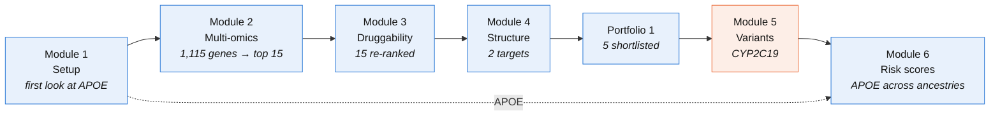
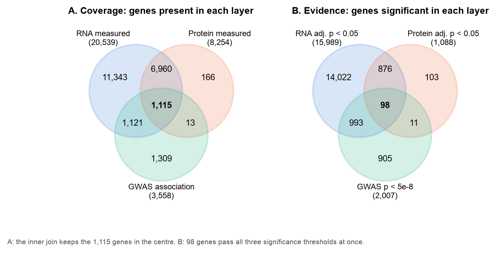

# BIOT 6900 coursework

Dhairya Bhatia (bhatia.dh@northeastern.edu) · Northeastern University

[Open the interactive page →](https://dhairyab0069.github.io/biot6900/)

This repository has my work for BIOT 6900. I chose Alzheimer's disease in Module 2 and kept it for most of the course, so the modules build on each other: I found genes linked to Alzheimer's, checked which of them a drug could reach, looked at their structures, and then tested how well a genetic risk score works across ancestries. Module 5 used an assigned gene instead.

## How the modules connect



Blue modules follow Alzheimer's disease; Module 5 (orange) used the assigned gene CYP2C19.

## At a glance

| | | |
|:---:|:---:|:---:|
| [](module2/) | [](module3/) | [](module4/) |
| [Module 2](module2/): which genes change in RNA, protein and DNA | [Module 3](module3/): small molecule or antibody? | [Module 4](module4/): is there a drug pocket? |
| [](module5/) | [](module6/) | [](portfolio1/) |
| [Module 5](module5/): can scores classify CYP2C19 variants? | [Module 6](module6/): does a risk score travel? | [Portfolio 1](portfolio1/): my target shortlist |

Click a figure to open that module's folder.

## The modules

Each folder has its own README (what I did, data sources and what didn't work) and my report as `REPORT.pdf`. Click a module to expand it.

<details>
<summary><b>Module 1 · Setup</b>: is everything working, and what does a database say about APOE?</summary>

<br>

I set up the `biot6900` environment, translated a short DNA sequence with BioPython and ran my first queries to PubMed, UniProt, the PDB and the GWAS Catalog. The last query was rs7412, a variant in APOE, the gene with the largest single effect on Alzheimer's risk. APOE comes back in most of the later modules.

[Folder](module1/) · [Notebook](module1/module1_setup.ipynb)

</details>

<details>
<summary><b>Module 2 · Multi-omics</b>: which genes change in Alzheimer's at the RNA, protein and DNA level?</summary>

<br>

I combined three kinds of public data: brain RNA and brain protein from AMP-AD (Agora), and published Alzheimer's GWAS results. Known Alzheimer's genes came out near the top, which made me more confident the method works.

| Genes in all three layers | Same direction in RNA and protein | APOE's rank |
|:---:|:---:|:---:|
| 1,115 | 635 (57%) | 11 (HLA-DRB1 is 2) |


[Report (PDF)](module2/REPORT.pdf) · [Folder](module2/) · [Top 15 targets](module2/targets_ad.csv)

</details>

<details>
<summary><b>Module 3 · Protein language models</b>: which of my 15 genes look like proteins a drug could act on?</summary>

<br>

I used protein language model embeddings to compare my 15 proteins with proteins that already have drugs, and to ask whether a small molecule or an antibody would suit each one better. Most of my list were cell-surface proteins that suit antibodies. APLNR was the one clear small-molecule candidate.

| Gene | Module 2 rank | Final rank | Better suited to |
|---|:---:|:---:|---|
| PECAM1 | 4 | 1 | antibody (0.88) |
| HLA-DRB1 | 2 | 2 | antibody (0.27) |
| ITGAX | 6 | 4 | antibody (0.59) |
| APLNR | 10 | 6 | small molecule (0.68) |
| APOE | 11 | 13 | neither |


[Report (PDF)](module3/REPORT.pdf) · [Folder](module3/) · [Re-ranked targets](module3/targets_ad_w3.csv)

</details>

<details>
<summary><b>Module 4 · Structure</b>: do my two lead targets have a place where a drug could bind?</summary>

<br>

I checked how confident AlphaFold was about ITGAX and APLNR, compared them with structures solved in the lab and searched for pockets. APLNR has a pocket where a real drug binds, so a small molecule looks possible. ITGAX was less clear, so I think an antibody is the more realistic option.

| | ITGAX | APLNR |
|---|:---:|:---:|
| Mean pLDDT | 88.0 | 81.7 |
| RMSD to the lab structure | 0.86 Å (4NEH) | 1.11 Å (7SUS) |
| My call | possible but uncertain, antibody | supports a small-molecule pocket |


[Report (PDF)](module4/REPORT.pdf) · [Folder](module4/) · [Summary table](module4/structure_assessment_ad.csv)

</details>

<details>
<summary><b>Portfolio 1</b>: my shortlist of Alzheimer's targets</summary>

<br>

I put Labs 2 to 4 together into one report and ranked five targets across all three kinds of evidence.

| Rank | Target | Drug type |
|:---:|---|---|
| 1 | APLNR | small molecule |
| 2 | ITGAX | antibody |
| 3 | PECAM1 | antibody |
| 4 | HLA-DRB1 | antibody, exploratory |
| 5 | APOE | exploratory |

[Report (PDF)](portfolio1/REPORT.pdf) · [Folder](portfolio1/)

</details>

<details>
<summary><b>Module 5 · Variant interpretation</b>: can variant-effect scores classify CYP2C19's uncertain variants?</summary>

<br>

CYP2C19 is a liver enzyme that switches on the heart drug clopidogrel. I calibrated variant-effect scores against known labels and tried to reclassify 33 variants of uncertain significance. The scores put CYP2C19's own known broken alleles in a "benign" band, so I did not trust them and left all 33 as uncertain.

| ClinVar variants | Labelled pathogenic | Uncertain, before → after |
|:---:|:---:|:---:|
| 80 | 0 | 33 → 33 |


[Report (PDF)](module5/REPORT.pdf) · [Folder](module5/) · [Classified variants](module5/pgx_classified_CYP2C19.csv)

</details>

<details>
<summary><b>Module 6 · Polygenic risk</b>: does an Alzheimer's risk score work equally well across ancestries?</summary>

<br>

I applied a published 22-SNP Alzheimer's risk score to 2,336 genomes from five ancestry groups. The disease labels were simulated by the course, so the AUCs illustrate the problem rather than measure real risk.

| AUC | EUR | SAS | EAS | AMR | AFR |
|---|:---:|:---:|:---:|:---:|:---:|
| Full score | 0.672 | 0.611 | 0.575 | 0.555 | 0.493 |
| Without the 2 APOE SNPs | 0.588 | 0.582 | 0.588 | 0.557 | 0.580 |

Without APOE every group sits near 0.58, so the drop in the African-ancestry group comes from how the course data simulated APOE's effect, not from APOE biology.


[Report (PDF)](module6/REPORT.pdf) · [Folder](module6/)

</details>

## Running the notebooks

```bash
conda activate biot6900
jupyter lab
```

Open a module's notebook and run Kernel → Restart & Run All. Course data packs from Canvas (Modules 3 and 6) go in that module's `data/` folder and are not committed. Module 2 downloads its own data with `scripts/get_data.py`, and Module 4 downloads structures on first run.

The interactive page is `index.html` in this folder, served by GitHub Pages.
