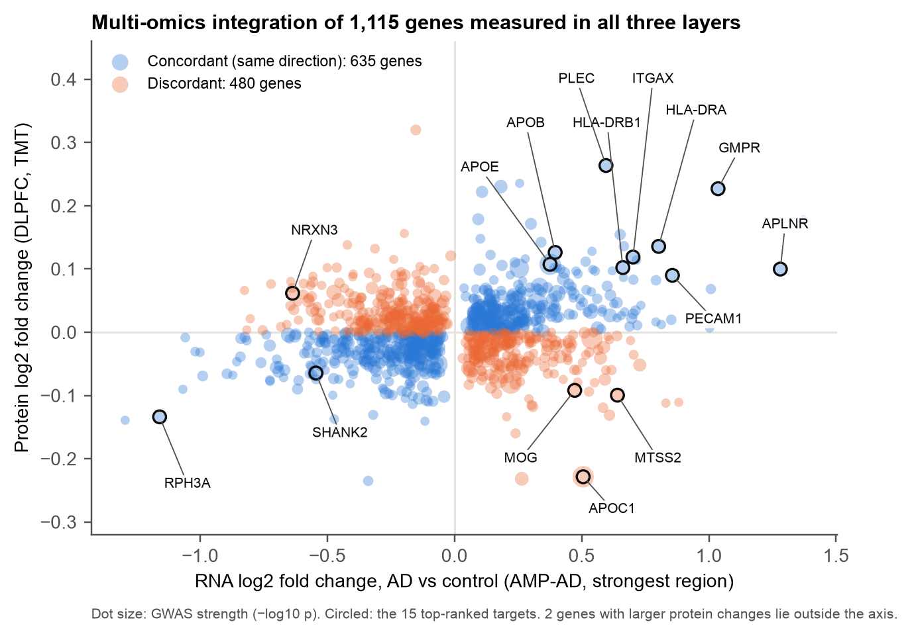
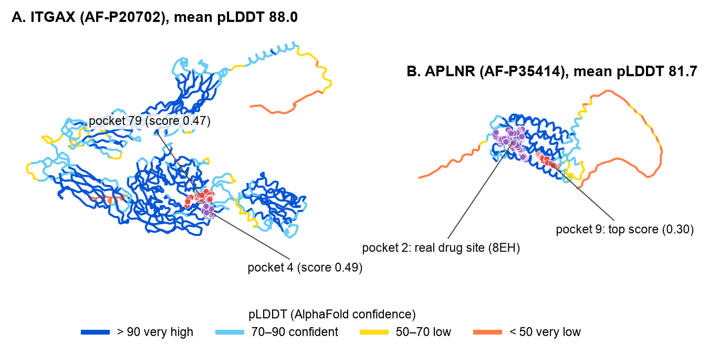
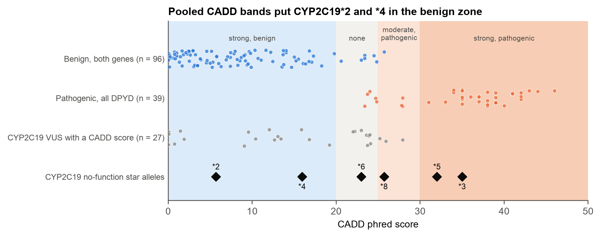
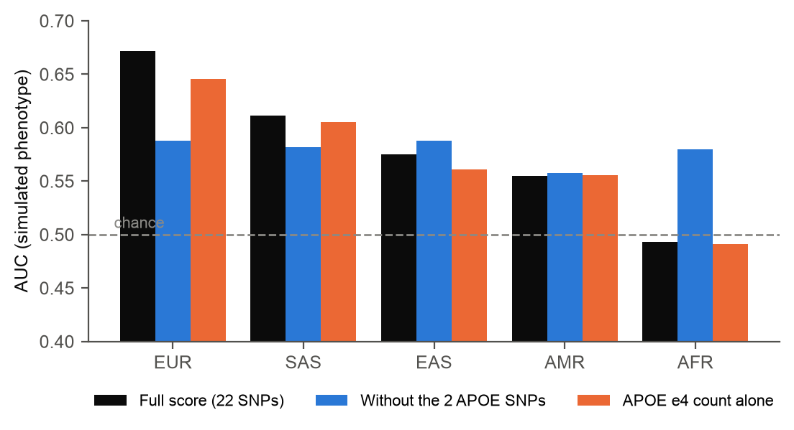
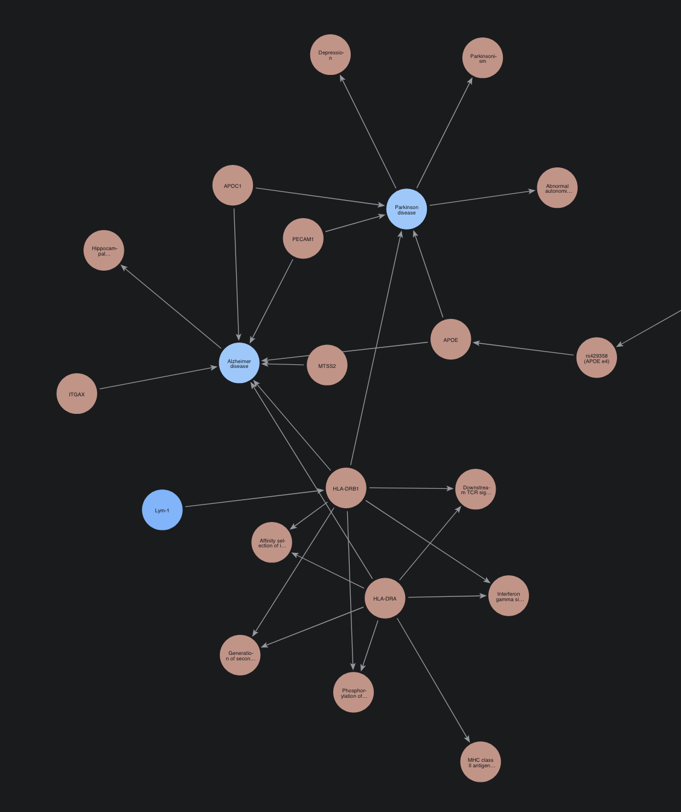

# BIOT 6900 coursework

Dhairya Bhatia (bhatia.dh@northeastern.edu) · Northeastern University

This repository has my work for BIOT 6900. I chose Alzheimer's disease in Module 2 and kept it for most of the course, so the modules build on each other: I found genes linked to Alzheimer's, checked which of them a drug could reach, looked at their structures, and then tested how well a genetic risk score works across ancestries. Module 5 used an assigned gene instead.

| Folder | Module | Question |
|---|---|---|
| [`module1/`](module1/) | 1. Setup | Is the environment working, and what does a database say about APOE? |
| [`module2/`](module2/) | 2. Multi-omics | Which genes change in Alzheimer's at the RNA, protein and DNA level? |
| [`module3/`](module3/) | 3. Protein language models | Which of those genes look like proteins we already know how to drug? |
| [`module4/`](module4/) | 4. Structure | Do the best two have a place on their 3D structure where a drug could bind? |
| [`portfolio1/`](portfolio1/) | Portfolio 1 | Labs 2 to 4 brought together into one ranked target package |
| [`module5/`](module5/) | 5. Variant interpretation | How do a patient's variants in CYP2C19 change the drugs they can take? |
| [`module6/`](module6/) | 6. Polygenic risk | Does an Alzheimer's risk score work equally well across ancestries? |
| [`module7/`](module7/) | 7. Knowledge graph | Once all my evidence is connected in one graph, which genes stand out? |

Each folder has its own README (what I did, data sources and what didn't work) and my report as `REPORT.pdf`.

## How the modules connect

### 1. A first look at APOE

In [Module 1](module1/) I set up the environment and ran my first queries to PubMed, UniProt, the PDB and the GWAS Catalog. The last query was rs7412, a variant in APOE, the gene with the largest single effect on Alzheimer's risk. APOE comes back in most of the later modules.

### 2. Which genes change in Alzheimer's?

In [Module 2](module2/) I combined three kinds of public data: brain RNA and brain protein from AMP-AD (Agora), and published Alzheimer's GWAS results. 1,115 genes were measured in all three, and I gave each one a combined score. Known Alzheimer's genes came out near the top (HLA-DRB1 at 2, APOE at 11, CLU at 31), which made me more confident the method works. My top 15 fell into immune, lipid, synapse and blood-vessel groups.



### 3. Which of them could a drug reach?

In [Module 3](module3/) I used protein language model embeddings to check whether each of my 15 proteins looks like proteins that already have drugs, and whether a small molecule or an antibody would fit better. Most of my list were cell-surface proteins that suit antibodies. APLNR, a G-protein-coupled receptor, was the one clear small-molecule candidate.


### 4. Is there a pocket on the structure?

In [Module 4](module4/) I took my two lead targets, ITGAX and APLNR, checked how confident AlphaFold was about each, compared them with structures solved in the lab and searched for pockets. APLNR has a pocket where a real drug binds, so a small molecule looks possible. ITGAX was less clear, so I think an antibody is the more realistic option.



### Portfolio 1: the target package

For [Portfolio 1](portfolio1/) I put Labs 2 to 4 together into one report, ending with my ranked shortlist: APLNR, ITGAX, PECAM1, HLA-DRB1 and APOE.

### 5. From the drug to the patient

[Module 5](module5/) moved from finding targets to how patients respond to drugs, using the assigned gene CYP2C19. It is a liver enzyme that switches on clopidogrel and breaks down several common drugs. I calibrated variant-effect scores against known labels and tried to reclassify 33 variants of uncertain significance. The scores put CYP2C19's own known broken alleles in a "benign" band, so I did not trust them and left all 33 as uncertain.



### 6. Back to APOE: does genetic risk travel?

In [Module 6](module6/) I came back to APOE as part of a 22-SNP Alzheimer's risk score, which I applied to 2,336 genomes from five ancestry groups. The score worked best in Europeans (AUC 0.672) and was no better than chance in the African-ancestry group (0.493). When I removed the two APOE SNPs, every group came out at about 0.58, so the drop comes from how the course data simulated APOE's effect, not from APOE biology.



### 7. Putting it all in one graph

In [Module 7](module7/) I loaded my 15 genes and their evidence from Modules 2–6 into a Neo4j knowledge graph, with public pathways, drugs, related diseases and symptoms from Open Targets, and 200 patients from the Module 6 cohort. Combining network position with my scores ranked PECAM1, APOC1, ITGAX, HLA-DRB1 and APOE on top, four of them from my Portfolio 1 shortlist. The graph also found real drugs on my genes (mipomersen on APOB, apelin on APLNR) and linked HLA-DRB1 to Parkinson's through shared symptoms.



## Running the notebooks

```bash
conda activate biot6900
jupyter lab
```

Open a module's notebook and run Kernel → Restart & Run All. Course data packs from Canvas (Modules 3 and 6) go in that module's `data/` folder and are not committed; Module 2 downloads its own data with `scripts/get_data.py`, and Module 4 downloads structures on first run.
