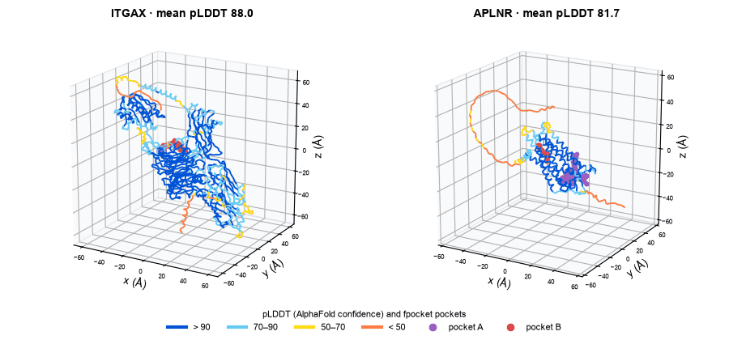

# Which Alzheimer's Genes Could a Drug Reach? Following One Disease from GWAS to Drug Pockets

[](https://dhairyab0069.github.io/biot6900-io/)
[](https://github.com/dhairyab0069/biot6900)



*The AlphaFold models of my two lead Alzheimer's targets, coloured by how confident AlphaFold is in each
part (pLDDT). Purple and red points are pockets found by fpocket. On APLNR (right), the purple pocket is
where a real drug binds in the lab structure.*

**Jump to:** [Summary](#summary) · [Results](#4-results) · [Shortlist](#44-the-shortlist) · [Risk scores across ancestries](#46-does-a-risk-score-work-across-ancestries) · [Limitations](#5-limitations) · [**Reproduce it**](#6-how-to-reproduce) · [Where things are](#7-where-things-are) · [Interactive report](https://dhairyab0069.github.io/biot6900-io/)

## Summary

This is my BIOT 6900 coursework, by Dhairya Bhatia. I chose Alzheimer's disease in Module 2 and kept it for
most of the course, so each module builds on the last. I asked one question in stages: **which genes are
involved in Alzheimer's, which of them could a drug act on, and does the protein have a place for the drug
to bind?** Then I asked how well genetic risk carries across ancestries, and, with an assigned gene, how a
patient's DNA changes their response to a drug.

What I found:

- **1,115 genes have evidence in brain RNA, brain protein and DNA at the same time.** Known Alzheimer's genes
  rank near the top (HLA-DRB1 2nd, APOE 11th, CLU 31st), which made me more confident in the method
  (Section 4.1).
- **Most of my top 15 suit antibodies, not pills.** They are mostly cell-surface proteins. APLNR, a
  G-protein-coupled receptor, is the one clear small-molecule candidate. APOE, the strongest genetic signal,
  looks like no drugged protein (Section 4.2).
- **APLNR has a confident pocket where a real drug binds; ITGAX has none.** The drug site in APLNR's
  predicted structure has a pLDDT of 95.1, even though fpocket ranks that pocket only 4th (Section 4.3).
- **My final shortlist is APLNR, ITGAX, PECAM1, HLA-DRB1 and APOE** (Section 4.4).
- **For CYP2C19, variant scores can't be trusted.** CADD puts the gene's own known broken alleles, \*2 and
  \*4, in the "benign" band, so I left all 33 uncertain variants as uncertain (Section 4.5).
- **A published Alzheimer's risk score works best in Europeans (AUC 0.672) and is at chance in the
  African-ancestry group (0.493).** Without its two APOE SNPs every group sits near 0.58, so the drop comes
  from how the course data simulated APOE, not from APOE biology (Section 4.6).

## 1. Background

Alzheimer's disease is the most common cause of dementia, and there are still very few treatments for it.
A disease leaves traces in several layers at once:

1. **RNA**: which genes are switched on, and how strongly.
2. **Protein**: which proteins are actually made.
3. **DNA**: which inherited variants raise the risk. These come from **genome-wide association studies
   (GWAS)**, which compare the DNA of people with and without the disease.

A gene that changes in only one layer could be noise or a side effect of the disease. A gene that shows up
in all three is harder to dismiss.

Being involved in a disease doesn't make a gene a drug target, though. A **small molecule** (a pill) needs a
pocket on the protein to sit in. An **antibody** needs the protein to be reachable, usually on the cell
surface. So after finding genes, I asked which ones look like proteins that already have drugs, and then
looked at their 3D shape for pockets.

Two terms come up often:

- **pLDDT** is AlphaFold's confidence in each part of a predicted structure, from 0 to 100. Above 90 is
  very high; below 50 is close to a guess. A pocket in a low-confidence region may not be real.
- **AUC (or AUROC)** asks: if you pick one case and one control, how often does the score rank the case
  higher? 1.0 is perfect and 0.5 is a coin flip.

## 2. Data

Every dataset is public or provided by the course.

| Module | Data | Source | Size |
|---|---|---|---|
| 2 | Brain RNA, AD against control (3 donor groups, 9 regions) | AMP-AD via Agora [1] | 20,539 genes |
| 2 | Brain protein, AD against control (prefrontal cortex) | AMP-AD via Agora [1] | 8,254 genes |
| 2 | Every published AD association | GWAS Catalog [2] | 3,558 genes |
| 3 | Protein language model embeddings and tractability labels | Course data pack: ESM C [3], ESM-2 [4], Open Targets [5] | 20,190 proteins |
| 4 | Predicted structures | AlphaFold DB [6, 7] | ITGAX (P20702), APLNR (P35414) |
| 4 | Lab structures | RCSB PDB: 4NEH, 3K6S, 7SUS, 1CQP | 4 entries |
| 5 | Clinical labels, CADD, REVEL, AlphaMissense, gnomAD | ClinVar [8], CADD [9], via MyVariant.info [10] | 80 CYP2C19 variants |
| 6 | A published AD risk score and real genomes | PGS000334 [11], 1000 Genomes [12] | 22 SNPs, 2,336 people |

The data in Modules 2 to 4 is **gene-level**: one number per gene, not per person. Module 6's disease
labels are **simulated** by the course, because 1000 Genomes has no medical records.

## 3. Method

### 3.1 Multi-omics scoring (Module 2)

- For RNA, keep each gene's biggest change across brain regions, skipping the cerebellum, which Alzheimer's
  mostly spares.
- Keep only genes present in all three layers (an inner join on the gene symbol).
- Turn each layer into a 0-to-1 rank (by size of change, or GWAS strength) and average the three with
  equal weight. Ranking first stops APOE's huge GWAS signal from dominating.
- Mark a gene **concordant** if RNA and protein move the same way.

### 3.2 Druggability (Module 3)

- Represent every protein by its protein language model embedding.
- Train a classifier on a 1,201-protein panel labelled by whether each protein already has a
  small-molecule or antibody drug, then score my 15 genes (p_sm and p_ab).
- Check the classifier two ways: a random split, and a stricter split that holds out whole protein
  families.
- Re-rank the 15 by combining the Module 2 score with the druggability scores.

### 3.3 Structure (Module 4)

- Download the AlphaFold models of my two lead targets and read pLDDT and PAE.
- Compare each with a lab structure by RMSD over confident residues.
- Find pockets with fpocket [13], reject those lined by low-confidence residues, and check APLNR's pockets
  against the real drug (8EH) in 7SUS.

### 3.4 Variant interpretation (Module 5)

- Fetch every ClinVar variant in CYP2C19 with its scores and frequency.
- Calibrate CADD into evidence bands using labelled variants, pooled with DPYD because CYP2C19 has no
  pathogenic labels of its own.
- Test the bands on CYP2C19's known no-function star alleles before using them on the uncertain variants.

### 3.5 Polygenic risk (Module 6)

- Line up each score SNP with the genotype's alleles (keep, flip or drop), then sum dosage times weight.
- Measure AUC overall and per ancestry, the share of each group above one pooled top-10% cutoff, and
  calibration of a model fitted on Europeans only.
- Extra check: recompute each group's AUC without the two APOE SNPs, and with APOE e4 alone.

## 4. Results

### 4.1 Which genes change in Alzheimer's

| Measure | Value |
|---|---|
| Genes in all three layers | 1,115 |
| RNA and protein move the same way | 635 (57%) |
| Significant in all three layers | 98 |
| Rank of HLA-DRB1 / APOE / CLU / BIN1 | 2 / 11 / 31 / 53 |


*Figure 1. RNA against protein change for the 1,115 genes. Blue moves the same way in both, orange disagrees.
Dot size is GWAS strength; my top 15 are circled.*

My top 15 fall into four groups, all known to change in Alzheimer's: brain immune cells (HLA-DRA, HLA-DRB1,
ITGAX), fat transport (APOC1, APOE, APOB), synapses (RPH3A, NRXN3, SHANK2) and blood vessels (PECAM1,
APLNR).

### 4.2 Which could a drug reach

| Gene | Module 2 rank | Final rank | Small molecule (p_sm) | Antibody (p_ab) |
|---|---|---|---|---|
| PECAM1 | 4 | 1 | 0.02 | 0.88 |
| HLA-DRB1 | 2 | 2 | 0.01 | 0.27 |
| ITGAX | 6 | 4 | 0.21 | 0.59 |
| APLNR | 10 | 6 | 0.68 | 0.03 |
| APOE | 11 | 13 | 0.00 | 0.01 |


*Figure 2. Small-molecule against antibody score for my 15 targets.*

The classifier scores AUROC 0.839 on a random split but 0.745 when whole protein families are held out, so
the random split overstates it. I used the scores to adjust the ranking, not to override it.

### 4.3 Is there a pocket

| Measure | ITGAX | APLNR |
|---|---|---|
| Mean pLDDT | 88.0 | 81.7 |
| Residues with pLDDT below 50 | 3.4% | 15.5% |
| RMSD to the lab structure | 0.86 Å (4NEH) | 1.11 Å (7SUS, insert removed) |
| pLDDT at the real drug site | – | 95.1 |
| fpocket rank of the real drug pocket | – | 4th |

- **APLNR:** the real drug sits in a confident pocket, so a small molecule looks possible, even though
  fpocket's own score prefers a different pocket.
- **ITGAX:** each piece is confident, but the pieces' arrangement is not, and no pocket is convincing. An
  antibody is the realistic route.

The animation at the top shows both models; the [interactive report](https://dhairyab0069.github.io/biot6900-io/#s4)
lets you rotate them and fly to each pocket.

### 4.4 The shortlist

| # | Target | Drug type | Main evidence |
|---|---|---|---|
| 1 | APLNR | small molecule | Confident pocket where a real drug binds |
| 2 | ITGAX | antibody | RNA and protein both up; no reliable pocket |
| 3 | PECAM1 | antibody | Strongest antibody score (0.88); structure not assessed |
| 4 | HLA-DRB1 | antibody, exploratory | Strong genetics (−log10 p 22.5) |
| 5 | APOE | exploratory | Strongest known gene, but looks like no drugged protein |

The full write-up is the [Portfolio 1 report](portfolio1/REPORT.pdf).

### 4.5 Can variant scores classify CYP2C19

| Measure | Value |
|---|---|
| ClinVar variants | 80 (64 rsIDs) |
| Labelled pathogenic | 0 (broken alleles are filed as "drug response") |
| CADD for \*2 / \*4 | 5.7 / 15.9, both in the "strong, benign" band |
| Uncertain variants before → after | 33 → 33 |


*Figure 3. CADD bands from pooled labelled variants. CYP2C19's no-function alleles \*2 and \*4 land in the
"strong, benign" band, so the bands can't be trusted for this gene.*

### 4.6 Does a risk score work across ancestries

| Ancestry | n | AUC | AUC without APOE | Above pooled top-10% cutoff |
|---|---|---|---|---|
| European (EUR) | 500 | 0.672 | 0.588 | 7.8% |
| South Asian (SAS) | 489 | 0.611 | 0.582 | 4.3% |
| East Asian (EAS) | 500 | 0.575 | 0.588 | 2.2% |
| Admixed American (AMR) | 347 | 0.555 | 0.557 | 6.3% |
| African (AFR) | 500 | 0.493 | 0.580 | 28.0% |


*Figure 4. AUC by ancestry for the full score, the score without its two APOE SNPs, and APOE e4 alone.*

- **The score works best in the group it was built in.** It was learned mostly from European studies.
- **The African-ancestry drop is an artifact of the simulation.** The course linked e4's effect to a nearby
  SNP that travels with e4 in Europeans but not in Africans. Removing APOE brings every group to about
  0.58. In real cohorts e4 is a risk allele in African-ancestry people too.
- **One cutoff is not fair.** It flags 28% of the African-ancestry group and 2% of the East Asian group.
- **The score adds a little to age:** cross-validated AUC rises from 0.562 to 0.618.

## 5. Limitations

- **Gene-level data only.** Modules 2 to 4 use one number per gene, not per person, so nothing here is
  about individual patients.
- **Two structures.** Only ITGAX and APLNR were assessed structurally; PECAM1, HLA-DRB1 and APOE have no
  structure evidence.
- **Druggability is resemblance.** The scores say a protein looks like past drug targets, not that a drug
  will work.
- **Simulated phenotype.** Module 6's AUCs illustrate the portability problem; they don't measure real
  Alzheimer's risk.
- **Coursework scale.** Each module was about one week, with one run per analysis and no confidence
  intervals.

## 6. How to reproduce

| | What you get | Needs | Time |
|---|---|---|---|
| [6.1](#61-read-the-results) | Every number in this README, in the reports | A browser | minutes |
| [6.2](#62-run-a-module) | One module's notebook, from its data | The `biot6900` conda environment; course data for Modules 3 and 6 | 5–30 minutes |
| [6.3](#63-remake-the-figures) | The report figures and this README's animation | The data folders each notebook writes | about a minute |

### 6.1 Read the results

Each module folder has a `REPORT.pdf` and a README with its data sources and what didn't work. The
[interactive report](https://dhairyab0069.github.io/biot6900-io/) has the same results with interactive
figures and the 3D structures.

### 6.2 Run a module

```bash
git clone https://github.com/dhairyab0069/biot6900.git
cd biot6900
conda activate biot6900
python module2/scripts/get_data.py       # Module 2 downloads its own data (about 140 MB)
jupyter lab                              # open a module's notebook, then Kernel → Restart & Run All
```

- **Module 3** needs the course data pack from Canvas, unzipped to `module3/data/`.
- **Module 4** downloads its AlphaFold and PDB files to `module4/structures/` on first run, and needs
  fpocket (`conda install -c conda-forge fpocket`).
- **Module 5** fetches CYP2C19 and DPYD from MyVariant.info on first run.
- **Module 6** needs the course `data.zip` from Canvas, unzipped to `module6/data/`.

### 6.3 Remake the figures

```bash
python module2/scripts/make_figures.py      # Figure 1 and the Module 2 report figures
python module3/scripts/make_figures.py      # Module 3 report figures (needs module3/data/)
python portfolio1/make_figures.py           # portfolio figures (needs module4/structures/)
python module5/scripts/make_figures.py      # Figure 3 (needs module5/data/)
cd module6 && python scripts/extra_checks.py && cd ..   # Figure 4 (needs module6/data/)
python scripts/make_readme_gif.py           # the animation at the top (needs module4/structures/)
```

## 7. Where things are

```
module1/          setup notebook and first database queries
module2/          multi-omics scoring: notebook, data download script, targets_ad.csv, figures, report
module3/          druggability with protein language models: notebook, re-ranked targets, figures, report
module4/          AlphaFold structures and pockets: notebooks, structure_assessment_ad.csv, figures, report
portfolio1/       Labs 2 to 4 brought together: report and figures
module5/          CYP2C19 variant interpretation: notebook, classified variants, figure, report
module6/          polygenic risk across ancestries: graded notebook, extra-check script, figures, report
figures/          the animation at the top of this README
scripts/          make_readme_gif.py
```

Course data packs (Modules 3 and 6) and downloaded structures are not committed; see each module's README.

## References

[1] A. K. Greenwood, K. S. Montgomery, N. Kauer et al. The AD Knowledge Portal: a repository for multi-omic
data on Alzheimer's disease and aging. *Current Protocols in Human Genetics*, 108(1), e105, 2020.

[2] E. Sollis, A. Mosaku, A. Abid et al. The NHGRI-EBI GWAS Catalog: knowledgebase and deposition resource.
*Nucleic Acids Research*, 51(D1), D977–D985, 2023.

[3] EvolutionaryScale. ESM Cambrian: revealing the mysteries of proteins with unsupervised learning. Blog
post, 2024.

[4] Z. Lin, H. Akin, R. Rao et al. Evolutionary-scale prediction of atomic-level protein structure with a
language model. *Science*, 379(6637), 1123–1130, 2023.

[5] D. Ochoa, A. Hercules, M. Carmona et al. The next-generation Open Targets Platform: reimagined,
redesigned, rebuilt. *Nucleic Acids Research*, 51(D1), D1353–D1359, 2023.

[6] J. Jumper, R. Evans, A. Pritzel et al. Highly accurate protein structure prediction with AlphaFold.
*Nature*, 596(7873), 583–589, 2021.

[7] M. Varadi, D. Bertoni, P. Magana et al. AlphaFold Protein Structure Database in 2024: providing
structure coverage for over 214 million protein sequences. *Nucleic Acids Research*, 52(D1), D368–D375, 2024.

[8] M. J. Landrum, J. M. Lee, M. Benson et al. ClinVar: improving access to variant interpretations and
supporting evidence. *Nucleic Acids Research*, 46(D1), D1062–D1067, 2018.

[9] P. Rentzsch, D. Witten, G. M. Cooper, J. Shendure, M. Kircher. CADD: predicting the deleteriousness of
variants throughout the human genome. *Nucleic Acids Research*, 47(D1), D886–D894, 2019.

[10] J. Xin, A. Mark, C. Afrasiabi et al. High-performance web services for querying gene and variant
annotation. *Genome Biology*, 17, 91, 2016.

[11] Q. Zhang, J. Sidorenko, B. Couvy-Duchesne et al. Risk prediction of late-onset Alzheimer's disease
implies an oligogenic architecture. *Nature Communications*, 11, 4799, 2020.

[12] The 1000 Genomes Project Consortium. A global reference for human genetic variation. *Nature*,
526(7571), 68–74, 2015.

[13] V. Le Guilloux, P. Schmidtke, P. Tufféry. Fpocket: an open source platform for ligand pocket
detection. *BMC Bioinformatics*, 10, 168, 2009.
