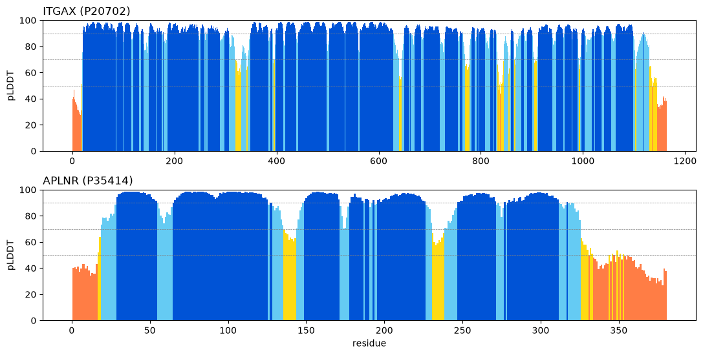
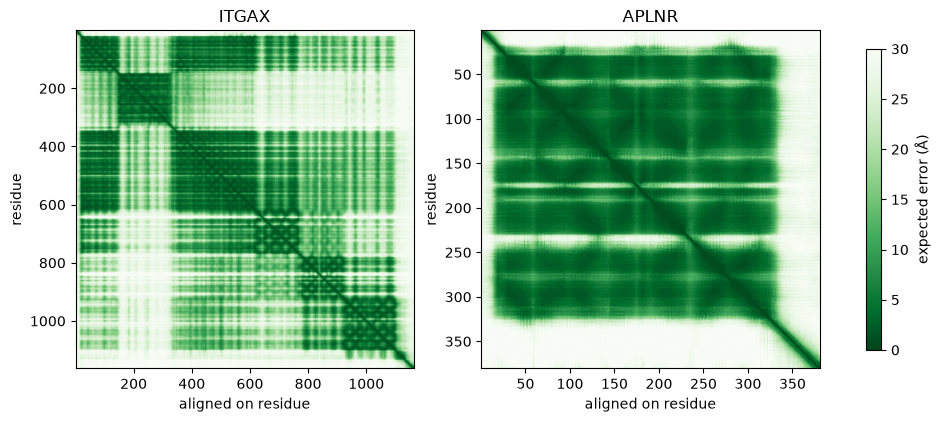

**Disease:** Alzheimer's disease (AD). **Targets:** two of the Week 4 picks from my Module 3 report.

| Gene | UniProt | Module 2 rank | Module 3 prior | Why |
|---|---|---:|---|---|
| ITGAX (CD11c) | P20702 | 6 | p_ab 0.59 | Marks the microglia that gather around plaques; its relative LFA-1 (ITGAL) has a small-molecule pocket in the same domain |
| APLNR (apelin receptor) | P35414 | 10 | p_sm 0.68 | A class A GPCR, my strongest small-molecule prior, with a crystal structure containing a bound small-molecule agonist |

Experimental structures: **4NEH** chain A for ITGAX (αXβ2 ectodomain, 2.75 Å, 1,084 residues, the best resolution among entries covering most of the protein) and **7SUS** chain A for APLNR (2.7 Å crystal with the small-molecule agonist 8EH bound). All numbers below come from my notebook.

{width=88%}

## 1. Which parts can I trust?

| Gene | Residues | Mean pLDDT | > 90 | < 50 | Stretches < 50 | Domains (PAE < 8 Å) |
|---|---:|---:|---:|---:|---|---|
| ITGAX | 1,163 | 88.0 | 65% | 3.4% | 1–18, 1145–1163 | 1 (20–1130) |
| APLNR | 380 | 81.7 | 57% | 15.5% | 1–16, 334–343, 354–380 | 1 (19–325) |

**APLNR:** the seven-helix bundle (19–325) is confident throughout, with mean PAE 5.8 Å inside it, so it is one rigid unit I trust for pockets. The untrusted parts are the termini. The N-terminus (1–16) is a flexible extracellular tail, and the C-terminal tail (after 334) is the intracellular region that GPCRs use to recruit β-arrestin after phosphorylation, so disorder there is expected rather than a failure. Two dips inside the bundle are the intracellular loops: ICL2 (about 135–145) and ICL3 (about 230–240). The crystallographers replaced ICL3 with a rubredoxin domain (7SUS residues 1001–1054) precisely because it is floppy, so the model and the experiment agree that this loop has no fixed shape.

**ITGAX:** almost everything except the signal peptide (1–18) and the cytoplasmic tail (1145–1163) is confident. The domain finder reports one domain, but the PAE heatmap shows that this is an artefact of single linkage, which merges blocks through a few low-PAE pairs. Read as blocks, the confident pieces are the β-propeller (mean PAE 4.7 Å within it) and the I domain (4.8 Å). Between them the PAE is **17.5 Å**, and between the headpiece and the calf legs it is **20.5 Å**. By the decision table (slide 12) each domain's shape is right but their arrangement is uncertain. So I trust pockets inside the I domain or inside the propeller, but not pockets that span domains. This matches integrin biology: integrins switch between bent and extended shapes, and the I domain's C-terminal α7 helix moves when the integrin is activated.

{width=78%}

\needspace{10\baselineskip}

## 2. How well does each prediction match experiment?

Residues were paired by sequence alignment, and only identical pairs with pLDDT ≥ 70 were used.

| Target, structure | Region | Residues | RMSD |
|---|---|---:|---:|
| ITGAX vs 4NEH | Whole chain | 1,020 | **0.86 Å** |
| | β-propeller / I domain / legs | 265 / 178 / 577 | 0.25 / 0.32 / 0.64 Å |
| ITGAX vs 3K6S (3.5 Å, for contrast) | Whole chain / propeller / I-domain core | — | 8.53 / 1.77 / 1.82 Å |
| APLNR vs 7SUS | Bundle, insert pairs excluded | 268 | **1.11 Å** |

**ITGAX:** the model matches 4NEH almost exactly, including the domain arrangement. The residues that differ most, 907–912 (up to 5.3 Å), are a loop in the lower leg (calf) region. The more informative result is the contrast with a second crystal of the same protein: against 3K6S, each domain still fits within 2 Å, but the whole chain is 8.5 Å off. Two experimental structures disagree on how the domains sit, which is exactly what the 17–20 Å inter-domain PAE warned about. The match to 4NEH shows that AlphaFold picked one real arrangement, not that the arrangement is fixed.

**APLNR:** the first RMSD over all identical pairs was 2.83 Å, because the alignment paired three APLNR residues (230, 239, 242) with rubredoxin residues that happen to share an amino acid. That is a pairing artefact caused by the engineered insert, not a prediction error. Without those pairs the RMSD is 1.11 Å, and only 13 of 268 residues are more than 2 Å apart. They sit in loops: ICL2 (134–135, up to 6.8 Å), the second extracellular loop (175–176) and residue 243 next to the insert junction. Those are differences the crystal has and the prediction lacks: a fusion protein, seven stabilising mutations and a bound agonist.

## 3. Pockets and druggability calls

Pockets were rejected if the mean pLDDT of their lining was below 70, and marked suspect if the PAE among the lining residues was above 10 Å.

| Gene | Pocket | Drug score | Volume (ų) | Mean pLDDT | PAE within | Verdict |
|---|---:|---:|---:|---:|---:|---|
| ITGAX | 4 | 0.489 | 284 | 89.0 | 2.6 | keep |
| | 79 | 0.470 | 927 | 89.3 | 3.2 | keep |
| | 3 | 0.098 | 517 | 92.2 | 1.8 | keep |
| | 26 | 0.093 | 434 | 90.3 | 2.6 | keep |
| | 71 | 0.083 | 371 | 92.7 | 1.9 | keep |
| APLNR | 9 | 0.304 | 428 | 94.2 | 2.0 | keep |
| | 22 | 0.182 | 364 | 91.2 | 2.2 | keep |
| | 10 | 0.111 | 951 | 82.0 | 4.3 | keep |
| | 2 | 0.015 | 1,761 | 94.0 | 3.1 | keep |
| | 1 | 0.010 | 714 | 78.4 | 5.5 | keep |

**APLNR, "Structure supports a small-molecule pocket":**

- **Confidence:** the residues within 4.5 Å of the real drug have mean pLDDT 95.1, and the whole pocket region is one rigid block.
- **Pocket:** the site is formed in the prediction. When I move 8EH from 7SUS into the model, fitting on the 68 residues around the site (0.60 Å), only 6 of 37 ligand atoms come closer than 2.2 Å to the model, and all of them touch the side chains of W85 and Y299. That is a side-chain adjustment on binding, not a missing pocket.
- **Experiment:** a small-molecule agonist binds this site in the crystal.
- **Caveat:** fpocket gives this pocket a low score; see Section 6.

**ITGAX, "Possible but uncertain", with an antibody as the realistic modality:**

- **Top pockets:** both of the best-scoring pockets (4 and 79, scores 0.49 and 0.47) are kept and sit on the β-propeller. In 4NEH they are not covered by β2 (closest atom 12–14 Å) or by modelled sugar (11–12 Å). Pocket 79's lining includes a glycosylation sequon (N385), although no glycan is modelled there in 4NEH.
- **Why the call is not stronger:** no ligand is known for either pocket, both scores sit below 0.5, and pocket 79 spans residues 104–388, so it may cross the propeller–I domain junction that PAE says is uncertain.
- **The site Module 3 pointed to is absent:** I borrowed lovastatin from the LFA-1 I-domain crystal (1CQP), which binds under the C-terminal α7 helix.
  - **Positive control:** fpocket finds that pocket in the LFA-1 crystal with the ligand removed (score 0.44, holding 72% of lovastatin, no clashes), so the method works.
  - **ITGAX:** placed into the ITGAX model, lovastatin clashes in 22 of 29 atoms, and no pocket holds more than 3% of it. The ITGAX I-domain crystal (1N3Y) gives the same answer: 27 of 29 atoms clash.
  - **Conclusion:** prediction and experiment agree that ITGAX does not have the preformed LFA-1-style allosteric pocket.
- **MIDAS:** the metal-ion site where natural ligands bind is a shallow, polar surface with no fpocket pocket.
- **Better route: an antibody.** ITGAX is a large extracellular protein with flat binding surfaces, and CD11c-blocking antibodies are standard research tools. For AD, the antibody would also need a brain-delivery design, because the target is on microglia behind the blood–brain barrier.

## 4. Integration with Modules 2 and 3

The structural calls match the Module 3 tractability prior: APLNR's small-molecule prior (0.68) is confirmed by a real, confident pocket, and ITGAX's antibody prior (0.59) is reinforced, because the one small-molecule idea I had for it (borrowing LFA-1's pocket) fails. I would keep both targets, with different jobs:

- **APLNR:** the small-molecule candidate. Its Module 2 rank (10) rested on strong PHG RNA change (log2FC 1.28) with only weak protein support (p = 0.068), so its AD relevance needs strengthening before chemistry.
- **ITGAX:** stays higher on disease evidence (rank 6, concordant RNA and protein), moved into an antibody track.

## 5. Limits from slide 22 that apply here

- **One snapshot:** the model shows APLNR in the inactive state. 7SUS has an agonist bound, and in a side check outside the notebook, the active-state cryo-EM structure with G protein (7W0L) differed most at the cytoplasmic end of TM6 (residues 235–240). For ITGAX the two crystals disagree on domain arrangement by 8.5 Å. **What would address it:** molecular dynamics of the receptor with and without 8EH, plus docking against the active-state cryo-EM structures. For ITGAX, compare bent and extended integrin structures before scoring any pocket that spans domains.
- **Missing pieces and no membrane:** both models are single chains. The ITGAX model has no β2 partner, no Mg2+ in the MIDAS and no glycans. The APLNR model has no lipid bilayer, yet the crystal contains a monoolein lipid (OLC) packed against the same pocket region, so the pocket's lipid-facing side is not modelled. **What would address it:** model the αXβ2 heterodimer with metal (AlphaFold-Multimer or Boltz-2 on the cluster), and embed APLNR in a membrane for simulation.
- **Cryptic pockets:** ITGAX's allosteric site may only open in another activation state. **What would address it:** a fragment screen or a thermal-shift assay on the purified I domain.

## 6. Ligand site (APLNR, 7SUS)

**Is my best kept pocket where the ligand sits?** No. 7SUS has one copy of the drug, 8EH (A1102), plus a monoolein lipid (OLC A1103) left over from the lipidic-cubic-phase crystallisation. The drug is the functional ligand: its 19 contact residues include W85, Y271 and Y299 deep in the helix bundle.

- **Best kept pocket:** pocket 9 (rank 1, score 0.304, residues 214–259) covers **0%** of the drug site. It lies between TM5 and TM6 in the inner half of the bundle, about 24 Å below the drug site along the membrane axis, and no ligand is known there.
- **The real site:** pocket 2 covers 68% of it. It is ranked only 4th, with a score of 0.015, despite mean pLDDT 94.0 and a confident lining.

**Why fpocket scores the real site so low:** GPCR orthosteric pockets for peptide ligands are large and open to the extracellular side. Apelin itself is a peptide that enters from outside. fpocket merged the deep drug site with this wide vestibule into one 1,761 ų cavity, and its druggability score penalises large, open, solvent-exposed pockets. In the apo model W85 and Y299 also partly fill the space the drug occupies. So the confidence checks and the experiment, not the druggability score, are what support the APLNR call.

## Anchor check: p53 (from lab Part 2)

The AlphaFold model of p53 matches 1TUP chain B at 0.68 Å over 192 confident residues. In 1TUP, C176, H179, C238 and C242 are zinc ligands (2.1–2.3 Å from the zinc), R248 and R273 contact DNA directly (3.4 and 2.5 Å), and R249 is near DNA. R175, Y220, G245 and R282 make no direct contact with either, so they are structural residues; R175 sits 5.3 Å from the zinc site it helps hold in place. For my Module 3 scores, this means the DNA-contact mutation R248Q (−9.55, 5.2nd percentile) scored as more surprising than the structural hotspot R175H (−5.97, 19.3rd). The language model ranks evolutionary constraint, not mechanism: only the structure shows that one mutant breaks a DNA contact while the other destabilises the fold around the zinc.
