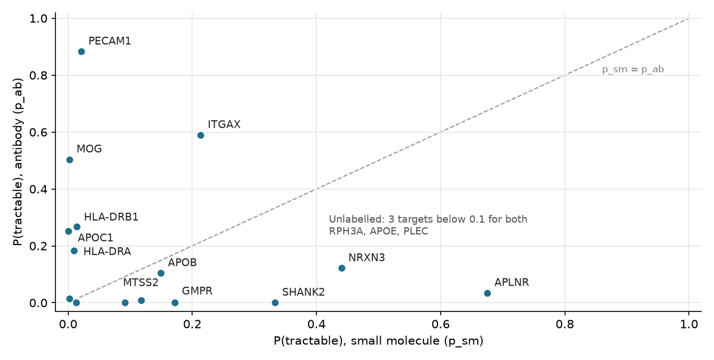

## 1. Introduction

For many families, Alzheimer's disease begins quietly: a forgotten name, a missed appointment, a familiar road that suddenly feels unfamiliar. Over time it takes away memory, independence and, eventually, the person their family knew. Science has learned a great deal about why this happens. Some of the genes that raise the risk were found more than thirty years ago (Corder et al., 1993), yet turning that knowledge into medicines has been slow, and the newest treatments slow the disease rather than stop it (van Dyck et al., 2023).

 One reason is that a gene linked to a disease is not always a good place for a drug to act. Alzheimer's genetics point to several kinds of biology: the brain's immune cells (microglia), the transport of fats, and the loss of connections between nerve cells. A useful target therefore has to pass three tests: it should be linked to the disease in more than one kind of data, a drug should be able to act on it, and its structure should show where.
 
 This brings us to the main question : **which Alzheimer's disease proteins are supported by RNA, protein and genetic evidence, could be reached by a known type of drug, and have a confidently predicted binding site, and which of them would be the most promising for a discovery team to study first?** The sections that follow answer it step by step, using my work from Labs 2 to 4.

## 2. Multi-omics integration (Lab 2)

**Data and choice:** I combined three open AD datasets: *RNA-seq from AMP-AD (Agora, three cohorts and nine brain regions)*, *TMT proteomics from the same programme (prefrontal cortex)*, and *every AD association in the GWAS Catalog (Greenwood et al., 2020; Sollis et al., 2023)*. Each is a per-gene summary, so I joined them on the gene symbol, checked whether RNA and protein move the same way, and ranked genes by an equal-weighted score.

*Surviving genes and concordance:*

- *Coverage:* 1,115 genes are measured in all three layers (Figure 2A). Proteomics limits coverage, since it measures 8,254 genes against 20,539 for RNA.
- *Concordance:* 635 of the 1,115 (57%) move in the same direction in RNA and protein (Figure 1).
- *Strong evidence everywhere:* 98 genes are significant in all three layers at once (Figure 2B).

{width=74%}

{width=80%}

**Biological reading:** the method recovers known AD genes. APOE ranks 11th and HLA-DRB1 2nd; *CLU (31)*, *BIN1 (53)* and *PICALM (83)* also appear. The top 15 fall into microglial activation (*HLA-DRA*, *HLA-DRB1*, *ITGAX*), lipid transport (*APOC1*, *APOE*, *APOB*), synaptic loss (*RPH3A*, *NRXN3*, *SHANK2*, all down) and blood vessels (*PECAM1*, *APLNR*). One hit is not a known AD gene: *GMPR (rank 7)* rises in both RNA (+1.04) and protein (+0.23), both strongly.

*A discordant gene, APOC1 (rank 3):* its *RNA rises* (+0.51) while *its protein falls* (−0.23), and both changes are significant. The likely reasons are that RNA and protein come from different brain regions, that APOC1 is secreted and leaves the tissue, or that the protein is trapped in plaques. Its huge *GWAS score* (−log10 p = 673) is also mostly borrowed from APOE, its neighbour on chromosome 19. I therefore do not carry APOC1 forward as a target.

## 3. Druggability triage (Lab 3)

Next, I asked whether each of the 15 targets looks like proteins that have already been drugged. Using *ESM C embeddings* and a classifier trained on proteins with *clinical precedence (Open Targets)*, I gave each target a *small-molecule prior (p_sm)* and an *antibody prior (p_ab)*, then re-ranked with weight 0.6 on the Lab 2 score and 0.4 on tractability (Lin et al., 2023; Ochoa et al., 2023).

{width=60%}

*Which targets survive as druggable:*

- *Antibody:* PECAM1 (p_ab 0.88), ITGAX (0.59) and MOG (0.50). All three sit on the cell surface, where antibodies can reach them.
- *Small molecule:* only APLNR (p_sm 0.68). It is a GPCR, and its nearest drugged neighbours (AGTR2, GHSR, S1PR2) are GPCRs of the same class.
- *No precedent:* RPH3A, PLEC and APOE score near zero for both. For APOE this reflects a modality problem, not unimportance.

*How far to trust it:* the prior agrees only weakly with the Lab 2 ranking (Spearman 0.21), as expected, because it measures resemblance to drugged proteins rather than disease link. Held out by protein family, it reaches AUROC 0.745 (0.839 on a random split), so it should adjust the ranking, not override it.

## 4. Structural assessment (Lab 4)

I took the two targets with the clearest modality signals, ITGAX (antibody, with a possible small-molecule pocket in a related protein) and APLNR (small molecule), and examined their AlphaFold models (Jumper et al., 2021; Varadi et al., 2024). Pockets were found with fpocket (Le Guilloux et al., 2009) and kept only where the lining had pLDDT ≥ 70.

{width=88%}

| | ITGAX (P20702) | APLNR (P35414) |
|----------|--------------------|--------------------|
| Mean pLDDT | 88.0 (3.4% below 50) | 81.7 (15.5% below 50) |
| Low-confidence parts | signal peptide and inner tail | the two tails (1–16 and after 334) |
| Match to experiment | 0.86 Å RMSD to 4NEH (1,020 residues) | 1.11 Å RMSD to 7SUS (268 residues) |
| Best pockets | 4 and 79 (scores 0.49 and 0.47) | 9 (0.30); real drug site is pocket 2 |
| Call | Possible but uncertain; antibody route | Structure supports a small-molecule pocket |

Table: Structure quality and pocket calls.

*APLNR:* the residues that touch the real agonist in the crystal (7SUS, ligand 8EH) have pLDDT 95.1, so the pocket is predicted confidently. When I moved the drug into the model, only 6 of its 37 atoms bumped into two side chains that would shift on binding. fpocket ranks this real site only 4th (score 0.015) because it merges it with the wide entrance for APLNR's natural peptide; here the crystal, not the pocket score, supports the call.

*ITGAX:* the model is confident within each domain, but the domains' arrangement is uncertain (PAE 17.5 Å between the I domain and the propeller), and an older crystal (3K6S) differs by 8.5 Å overall. Its top pockets score below 0.5 and pocket 79 spans two domains, so I do not trust it. The small-molecule idea from Lab 3 also fails: the lovastatin pocket of the related protein LFA-1 is absent in ITGAX, in both the prediction and its crystal (1N3Y).

## 5. Prioritized target package

| Rank | Target | Modality | Multi-omics (Lab 2) | Druggability (Lab 3) | Structure (Lab 4) |
|---:|------|---------|----------------------|--------|---------------------|
| 1 | APLNR | Small molecule | Rank 10; RNA +1.28, protein +0.10 (p = 0.068) | p_sm 0.68 | Confident pocket where a real drug binds |
| 2 | ITGAX | Antibody | Rank 6; RNA and protein both up (protein p = 0.005) | p_ab 0.59 | Confident domains; no reliable pocket |
| 3 | PECAM1 | Antibody | Rank 4; strong RNA, protein not significant | p_ab 0.88 | Not assessed (flat binding surfaces) |
| 4 | HLA-DRB1 | Antibody, exploratory | Rank 2; GWAS −log10 p 22.5 | p_ab 0.27 | Not assessed |
| 5 | APOE | Exploratory | Rank 11; the strongest known AD gene | near zero for both | Not assessed |

Table: Prioritized shortlist across the three layers.

*Why this order:*

- *APLNR first:* it is the only target with support in all three layers, including a structure-confirmed small-molecule pocket. That makes it the most ready for a drug programme. Its AD link is the weakest of the five at the protein level, so it ranks first on readiness, on condition that its AD link is confirmed (Section 6).
- *ITGAX second:* the most consistent disease evidence of the druggable targets: RNA and protein both rise, and it marks the microglia that gather around plaques (Keren-Shaul et al., 2017). The structure rules out a small molecule, so it goes forward as an antibody target.
- *PECAM1 third:* the strongest antibody prior, and it sits on the blood–brain barrier's vessel lining, so an antibody could reach it from the blood. Its protein change is not significant, which keeps it below ITGAX.
- *HLA-DRB1 fourth:* very strong genetics, but HLA-DR is central to immune function, so blocking it carries real safety risk, and its antibody prior is low.
- *APOE fifth:* the best-established AD gene, but no drug class fits it. It is worth a separate, exploratory approach, such as molecules that correct the shape of ApoE4.

## 6. Limitations and validation

*What this analysis cannot claim:*

- *Per-patient coupling:* the layers are unmatched summaries, so RNA–protein agreement is shown across genes, not within people.
- *Causation:* GWAS points to regions of DNA. APOC1 shows how one gene can inherit a neighbour's signal.
- *Lost genes:* TREM2, CD33 and MS4A6A are known AD genes but were dropped because the proteomics did not measure them.
- *History in the labels:* the druggability prior reflects where industry has worked, so undrugged classes score low partly because nobody has tried.
- *One frozen shape:* each structure is a single model without partner proteins, metal ions or a membrane, so pockets that only open in other shapes are missed.
- *Brain delivery:* nothing here models the blood–brain barrier, which matters most for ITGAX on microglia.

*How I would validate APLNR:*

1. *Confirm the AD link in tissue:* measure APLNR protein in human AD and control cortex by immunohistochemistry or targeted proteomics, focusing on blood vessels. This tests the weak protein evidence directly.
2. *Confirm the pocket is the functional site:* test a known APLNR agonist in a cell-based receptor assay, with and without mutations of W85 and Y299, the residues that line the predicted pocket.
3. *Test the biology:* treat human brain endothelial cells, or an AD mouse model, with that agonist and measure blood–brain barrier integrity and amyloid clearance.

## References

Berman, H. M., Westbrook, J., Feng, Z., Gilliland, G., Bhat, T. N., Weissig, H., Shindyalov, I. N., & Bourne, P. E. (2000). The Protein Data Bank. *Nucleic Acids Research, 28*(1), 235–242.

EvolutionaryScale. (2024). *ESM Cambrian* [Protein language model release]. https://www.evolutionaryscale.ai/blog/esm-cambrian

Greenwood, A. K., et al. (2020). The AD Knowledge Portal: A repository for multi-omic data on Alzheimer's disease and aging. *Current Protocols in Human Genetics, 108*(1), e105.

Jumper, J., Evans, R., Pritzel, A., et al. (2021). Highly accurate protein structure prediction with AlphaFold. *Nature, 596*(7873), 583–589.

Keren-Shaul, H., Spinrad, A., Weiner, A., et al. (2017). A unique microglia type associated with restricting development of Alzheimer's disease. *Cell, 169*(7), 1276–1290.

Le Guilloux, V., Schmidtke, P., & Tufféry, P. (2009). Fpocket: An open source platform for ligand pocket detection. *BMC Bioinformatics, 10*, 168.

Lin, Z., Akin, H., Rao, R., et al. (2023). Evolutionary-scale prediction of atomic-level protein structure with a language model. *Science, 379*(6637), 1123–1130.

Ochoa, D., Hercules, A., Carmona, M., et al. (2023). The next-generation Open Targets Platform: Reimagined, redesigned, rebuilt. *Nucleic Acids Research, 51*(D1), D1353–D1359.

Sollis, E., Mosaku, A., Abid, A., et al. (2023). The NHGRI-EBI GWAS Catalog: Knowledgebase and deposition resource. *Nucleic Acids Research, 51*(D1), D977–D985.

Varadi, M., Bertoni, D., Magana, P., et al. (2024). AlphaFold Protein Structure Database in 2024: Providing structure coverage for over 214 million protein sequences. *Nucleic Acids Research, 52*(D1), D368–D375.

*Structures:* RCSB PDB entries 4NEH, 3K6S and 1N3Y (ITGAX), 7SUS (APLNR with agonist 8EH) and 1CQP (LFA-1 with lovastatin), https://www.rcsb.org. *Data:* Agora, https://agora.adknowledgeportal.org; GWAS Catalog, https://www.ebi.ac.uk/gwas.
